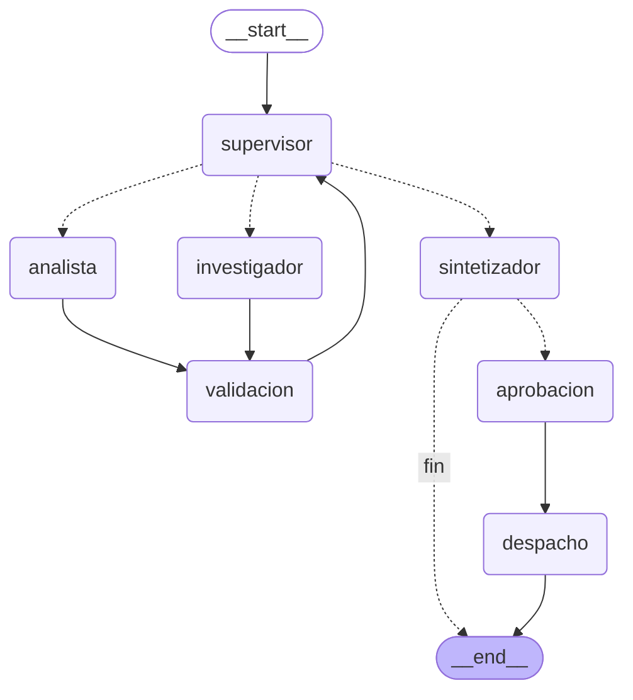

# Entrega final: Intelligence System (EmpresaFlomat)

**Python 3.12+** (declarado en `pyproject.toml`, `.python-version` y el `Dockerfile`) · FastAPI · LangGraph · Pinecone · Redis · Arize Phoenix

Sistema de IA de punta a punta (Modulo 8, CoderHouse - Desarrollo de
aplicaciones con LLMs) que responde preguntas complejas sobre las politicas
internas de una empresa (**envios, devoluciones, descuentos por volumen y
vacaciones**) combinando cuatro cosas:

1. **Conocimiento propio via RAG**: 4 PDF indexados en **Pinecone** y
   recuperados con una busqueda **hibrida** (BM25 + vectores, fusion RRF).
2. **Razonamiento multi-paso con agentes**: un **supervisor** (LangGraph)
   delega en un investigador, un analista y un sintetizador; un **arbitro
   determinista** valida cada entrega antes de seguir.
3. **API profesional y documentada**: **FastAPI** asincrona con cola y workers
   sobre **Redis**; los estados son `PENDING`, `RUNNING`, `WAITING_APPROVAL`,
   `DONE` y `FAILED`. Swagger en `/docs`.
4. **Trazabilidad completa**: cada respuesta cita sus fuentes (PDF y pagina), cada
   calculo se puede recalcular y cada ejecucion queda trazada en **Arize
   Phoenix** (costo, latencia, prompts y herramientas).

Ejemplo de tarea: *"Soy cliente mayorista y compro 60 unidades de $1.200 cada
una. ¿Cuanto pago en total con descuentos y envio?"*. El sistema recupera la
politica de descuentos y la de envios, calcula con funciones exactas (10% por
volumen + 3% mayorista = 13% → $62.640 → envio gratis por superar $50.000),
**verifica los numeros recalculandolos** y redacta la respuesta citando
`politica_descuentos.pdf` y `politica_envios.pdf`.

Este repositorio **unifica** la logica de las pre-entregas anteriores en un solo
proyecto: el orquestador multi-agente (Pre-entrega 6), la API de produccion con
Redis, HITL y Phoenix (Pre-entrega 7), el RAG hibrido con Pinecone (Pre-entrega
4), la fabrica de LLM con errores traducidos (Pre-entrega 1) y la cadena LCEL
con salida estructurada y reintentos (Pre-entrega 2). Ver la tabla de
[cumplimiento de la consigna](#cumplimiento-de-la-consigna).

## Diagrama del grafo

Los **nodos** son los cuadros; las lineas **punteadas** son aristas
condicionales (la ruta se decide en tiempo de ejecucion) y las continuas son
fijas.



| Nodo | Que hace | Herramientas | Escribe en el estado |
|---|---|---|---|
| `supervisor` | Decide quien actua ahora (LLM con salida estructurada `Decision`) y aplica **guardarrailes de codigo** sobre su propuesta | — | `siguiente`, `instruccion`, `decisiones` |
| `investigador` | Recupera fragmentos de politica con el RAG hibrido (ciclo ReAct) | `buscar_politicas` | `investigacion` |
| `analista` | Hace los calculos que pide la pregunta; **los numeros los producen funciones, nunca el LLM** | `calcular_descuento`, `calcular_total_pedido`, `calcular_envio`, `calcular_dias_vacaciones`, `verificar_plazo_devolucion` | `analisis` |
| `validacion` | **Arbitro determinista** (sin LLM): contrato Pydantic, procedencia de cada fragmento, recalculo de cada resultado, respaldo en la investigacion y coherencia entre calculos | — | `investigacion_valida`, `analisis_valido`, errores especificos |
| `sintetizador` | Redacta la respuesta final **solo con datos validados** (cadena LCEL con salida estructurada y reintentos) y agrega la linea `Fuentes:` | — | `respuesta_final`, `fuentes` |
| `aprobacion` | Solo tareas criticas: `interrupt()` pausa el grafo hasta que una persona decida | — | `aprobacion` |
| `despacho` | Unica accion con efectos secundarios: envia el informe **solo si fue aprobado** | — | `despacho` |

Despues del sintetizador, `ruta_tras_sintesis` decide: una tarea normal
termina; una tarea **critica** (la que pide *enviar* el informe a alguien con
`notificar_a`) pasa por `aprobacion` (pausa) y recien despues por `despacho`.

### Como regenerar el diagrama

El diagrama sale del grafo real, no esta dibujado a mano. No necesita `.env` ni
red (compilar el grafo no llama al LLM ni a Pinecone):

```bash
python -m scripts.generar_diagrama
```

Imprime el texto Mermaid para pegarlo en este README. Un test
(`test_script_del_diagrama`) comprueba que el script funciona y dibuja los 7
nodos.

## Arquitectura

```
                       POST /tasks         RPUSH            BLPOP
   cliente ──────────▶ API (FastAPI) ───────▶ Redis ◀────────────── worker(s) ──▶ grafo LangGraph
      ▲  GET /tasks/{id}      │   estado job:<id>   cola           (python -m app.worker)   │  │
      │  POST .../approve     └──────────────▶ checkpoints ◀───────────────────────────────┘  │
      └─────── polling ◀──────────────── (AsyncRedisSaver, thread_id = job_id)                  │
                                                                                                ▼
                  ┌──────────── trazas OpenTelemetry ───▶ Phoenix (:6006)          LLM (Anthropic u OpenAI)
                  │                                                                              │
   PDF (data/) ──▶ ingesta ──▶ Pinecone (vectores + metadata) ◀──── investigador ◀───────────────┘
                              BM25 en memoria (mismo corpus) ◀──────┘   (busqueda hibrida + RRF)
```

**Flujo de una tarea**: `POST /tasks` guarda el trabajo en Redis *antes* de
encolarlo y responde `202` con un `job_id` sin esperar al LLM. Un worker lo
toma, ejecuta el grafo (con `thread_id = job_id`, asi cada paso queda en un
checkpoint de Redis) y deja el resultado en el hash `job:<id>`. El cliente hace
polling con `GET /tasks/{id}`.

```
PENDING ──(un worker lo toma)──▶ RUNNING ──▶ DONE
                                    │
                                    ├──▶ WAITING_APPROVAL ──(POST /approve)──▶ PENDING ──▶ RUNNING ──▶ DONE
                                    │
                                    └──▶ FAILED   (excepcion, timeout o apagado del worker)
```

**Flujo del RAG** (`app/rag/`):

```
PDF ──▶ corpus.py: secciones numeradas ──▶ chunks con metadata (fuente, pagina, categoria, seccion) e id = sha256(contenido)
                                              │
                          ┌───────────────────┴────────────────────┐
              ingesta.py (una vez, idempotente)             recuperador.py (en cada busqueda)
              embeddings (Pinecone Inference) ──▶ upsert    ┌── BM25 local (hilo aparte) ───────┐
                                                            └── embedding ──▶ query Pinecone ───┴─▶ RRF ──▶ top-k
                                                                (filtro por categoria en las dos ramas)
```

## Que hace

1. **`app/main.py`** — la API FastAPI: `POST /tasks`, `GET /tasks/{id}` y
   `GET /health`, e incluye el router de aprobacion. Toda entrada y salida tiene
   un modelo Pydantic y Swagger (`/docs`) documenta cada endpoint, sus codigos de
   error y cada campo. `crear_app()` recibe la funcion que abre los recursos, asi
   los tests la reemplazan por Redis falso y LLM falsos.
2. **`app/jobs.py`** — el estado de los trabajos y la cola sobre Redis
   (`JobStore`). El estado es un hash `job:<id>`; la cola es la lista
   `tasks:queue`. Los cambios de estado son atomicos (`WATCH`/`MULTI`).
3. **`app/worker.py`** — saca trabajos de la cola, ejecuta el grafo y deja el
   resultado o el error en Redis. Corre como proceso aparte o embebido en la
   API (`WORKERS_EMBEBIDOS`).
4. **`app/graph.py`** — el `StateGraph` del orquestador (supervisor,
   especialistas, validacion, sintesis y tramo de aprobacion humana), compilado
   con el checkpointer de Redis.
5. **`app/supervisor.py`** — el LLM propone el siguiente paso con salida
   estructurada (`Decision`) y los guardarrailes de codigo lo corrigen si rompe
   una regla.
6. **`app/agents/`** — el investigador (RAG), el analista (calculos), el
   sintetizador (redaccion) y el subgrafo ReAct que comparten los dos primeros.
7. **`app/validation.py`** — el arbitro determinista: contrato, procedencia,
   recalculo, respaldo y coherencia.
8. **`app/calculos.py`** — las reglas de negocio como funciones puras con
   contratos Pydantic de entrada y salida; las usan el analista y el arbitro.
9. **`app/rag/`** — el RAG: `corpus.py` (PDF → fragmentos con metadata),
   `embeddings.py` y `almacen.py` (Pinecone con el SDK asincrono),
   `recuperador.py` (BM25 + vectores + RRF), `ingesta.py` y `reintentos.py`.
10. **`app/cadenas.py`** — la cadena LCEL del sintetizador (`prompt | modelo con
    salida estructurada`) con reintentos que dejan log.
11. **`app/hitl.py`** — la regla de criticidad, el nodo `aprobacion` (con
    `interrupt()`), el nodo `despacho` y el endpoint `POST /tasks/{id}/approve`.
12. **`app/observability.py`** — inicializa Phoenix (`phoenix.otel.register` con
    instrumentacion de LangChain/LangGraph) y abre un span raiz por trabajo con
    el `job_id` como `session.id`.
13. **`app/runtime.py`** — abre Redis, Pinecone, el checkpointer y el grafo; lo
    comparten la API y el worker.
14. **`app/config.py` / `app/llm.py`** — configuracion validada al arrancar
    (`Settings`) y fabrica del LLM (Anthropic u OpenAI) con los errores del
    proveedor traducidos a mensajes claros.
15. **`scripts/`** — `pruebas_sistema.py` (las 5 pruebas contra la API real) y
    `generar_diagrama.py`.
16. **`tests/`** — la suite con LLM, Redis y Pinecone falsos (ver
    [Tests y tipado](#tests-y-tipado)).

## Cumplimiento de la consigna

| Requisito de la consigna | Donde esta |
|---|---|
| **Integracion de codigo**: logica de los Modulos 6 y 7 en un proyecto unificado | Orquestador: `app/graph.py`, `supervisor.py`, `validation.py`, `agents/`. API de produccion: `app/main.py`, `jobs.py`, `worker.py`, `hitl.py`, `observability.py`, `runtime.py`. Se suman el RAG de la PE4 (`app/rag/`), la fabrica de LLM de la PE1 (`app/llm.py`) y la cadena LCEL de la PE2 (`app/cadenas.py`) |
| **Todo async** (LLM y bases de datos) | Redis: `redis.asyncio`. Checkpointer: `AsyncRedisSaver`. Pinecone: SDK oficial asincrono `PineconeAsyncio` + `IndexAsyncio` + `inference.embed`. LLM: `ainvoke`/`astream` de los modelos de LangChain (envuelven los SDK asincronos oficiales). HTTP: FastAPI + `httpx.AsyncClient` en los scripts. Lo unico bloqueante (leer PDF con `pypdf`, ranking BM25) corre en `asyncio.to_thread`. No hay `requests` en ningun lado |
| **Persistencia**: Checkpointer de LangGraph | `AsyncRedisSaver` sobre Redis Stack, con AOF y volumen (ver [Persistencia](#persistencia-y-reinicios)) |
| **Pydantic en entradas y salidas de la API y de las herramientas** | API: `TareaIn`, `AprobacionIn`, `Job`. Herramientas: cada una tiene su `args_schema` y una salida validada (`SalidaBusqueda`, `Salida*` de `calculos.py`). Agentes y arbitro: `Decision`, `ResultadoInvestigacion`, `ResultadoAnalisis`, `RespuestaFinal`. Configuracion: `Settings` validada al arrancar |
| **Observabilidad**: 5+ pruebas con trazas en Phoenix | `scripts/pruebas_sistema.py` (5 escenarios reales) y [capturas](#las-5-pruebas-del-sistema-y-sus-trazas) en `screenshots/` |
| **README con diagrama del grafo** | Este documento, [arriba](#diagrama-del-grafo) |
| **Despliegue local con una instruccion** | `docker compose up --build` o `./run.sh` |
| Sin hard-coding | Modelo del LLM, modelo de embeddings, indice y namespace de Pinecone, claves y todos los topes salen de variables de entorno (`.env.example`); el codigo no tiene valores por defecto para ellos |
| Sin secretos | `.env` esta en `.gitignore`; solo se versiona `.env.example` |
| Python 3.12+ | `requires-python = ">=3.12"` en `pyproject.toml`, `.python-version` y `FROM python:3.12-slim` en el `Dockerfile`; las dependencias estan fijadas en `requirements.txt` y los tests y el tipado corren en 3.12 |

## Como correrlo (una sola instruccion)

Requiere **Docker** y dos cuentas: un LLM (**Anthropic** u **OpenAI**) y
**Pinecone** (el plan gratuito alcanza).

Requiere tambien **Python 3.12 o superior** si se corre fuera de Docker (declarado en `pyproject.toml`, `.python-version` y el `Dockerfile`).

**1. Configurar las claves** (una sola vez; el archivo `.env` no se sube al repo):

```bash
cp .env.example .env           # en PowerShell: copy .env.example .env
```

Editar `.env` y completar `LLM_PROVIDER`, la key del proveedor, `LLM_MODEL` y
`PINECONE_API_KEY`. Los demas valores (indice, namespace, nube y region,
modelo de embeddings y su dimension) traen un ejemplo que funciona.

**2. Levantar todo:**

```bash
docker compose up --build      # o, en Linux / macOS / Git Bash: ./run.sh
```

Levanta cinco servicios y los ordena solos:

| Servicio  | Que es                                                                          | URL                          |
|-----------|---------------------------------------------------------------------------------|------------------------------|
| `redis`   | Redis Stack (Redis + RediSearch + RedisJSON): estado, cola y checkpoints        | `localhost:6379`             |
| `phoenix` | Dashboard de observabilidad                                                     | http://localhost:6006        |
| `ingesta` | Lee los PDF, crea el indice de Pinecone si no existe y sube los vectores. Termina sola | —                     |
| `api`     | FastAPI (solo recibe, encola y consulta)                                        | http://localhost:8000/docs   |
| `worker`  | Ejecuta el grafo. Escalable: `docker compose up --scale worker=3`               | —                            |

La API y el worker esperan a que la ingesta termine bien
(`service_completed_successfully`): si la key de Pinecone es invalida o la
dimension del indice no coincide, el sistema no arranca y el log dice por que.
La ingesta es **idempotente**: los ids salen del contenido, asi que volver a
correrla sobrescribe en vez de duplicar.

Comprobar que esta todo bien:

```bash
curl http://localhost:8000/health
# {"status":"ok","redis":true,"pendientes_en_cola":0}
```

> Si otro contenedor usa los puertos 6006 o 4317 (por ejemplo un Phoenix de
> otro ejercicio), frenarlo antes con `docker stop <nombre>`.

### Sin Docker (solo la API)

Redis tiene que ser **Redis Stack**: `docker run -d -p 6379:6379 redis/redis-stack-server:7.4.0-v3`.

```bash
python -m venv .venv && source .venv/bin/activate     # en Windows: .venv\Scripts\activate
pip install -r requirements.txt
cp .env.example .env                                  # completar las claves
python -m app.rag.ingesta                             # una vez: sube los PDF a Pinecone
uvicorn app.main:app --port 8000                      # la API levanta 2 workers propios (WORKERS_EMBEBIDOS=2)
```

## Probar la API

| Metodo y ruta               | Que hace                                                                                   | Respuestas        |
|-----------------------------|--------------------------------------------------------------------------------------------|-------------------|
| `POST /tasks`               | Crea la tarea, la encola y devuelve el `job_id` sin esperar. Cuerpo: `pregunta`, `notificar_a` (opcional) | 202, 422          |
| `GET /tasks/{id}`           | Estado, resultado, **fuentes citadas**, error y, si espera aprobacion, el borrador a revisar | 200, 404          |
| `POST /tasks/{id}/approve`  | Decision humana (`aprobado`, `comentario`); reanuda el grafo pausado                       | 202, 404, 409     |
| `GET /health`               | Comprueba que la API llega a Redis                                                         | 200, 503          |

```bash
# 1. Crear una tarea: responde enseguida con el job_id y status PENDING
curl -X POST http://localhost:8000/tasks -H "Content-Type: application/json" \
  -d '{"pregunta": "¿Cuantos dias corridos tiene un cliente para devolver un producto?"}'

# 2. Consultar el estado (repetir hasta DONE o FAILED)
curl http://localhost:8000/tasks/<job_id>
```

En PowerShell: `Invoke-RestMethod -Method Post -Uri http://localhost:8000/tasks -ContentType "application/json" -Body '{"pregunta": "Cuantos dias corridos tiene un cliente para devolver un producto?"}'`
y `Invoke-RestMethod http://localhost:8000/tasks/<job_id>`.

### Tarea critica con aprobacion humana (HITL)

Una tarea con `notificar_a` es **critica**: el sistema va a *enviar* el informe a
esa direccion (efecto secundario irreversible), asi que se pausa antes.

```bash
# 1. Crear la tarea critica
curl -X POST http://localhost:8000/tasks -H "Content-Type: application/json" \
  -d '{"pregunta": "Compro 60 unidades de $1.200 siendo mayorista, ¿cuanto pago con envio?", "notificar_a": "gerencia@empresa.com"}'

# 2. Consultar: queda en WAITING_APPROVAL y muestra el borrador en "aprobacion_pendiente"
curl http://localhost:8000/tasks/<job_id>

# 3. El revisor decide (aprobado: true envia el informe, false lo cancela)
curl -X POST http://localhost:8000/tasks/<job_id>/approve -H "Content-Type: application/json" \
  -d '{"aprobado": true, "comentario": "ok, mandalo"}'

# 4. Consultar: DONE, y "despacho" dice que se envio (o que se cancelo)
curl http://localhost:8000/tasks/<job_id>
```

El "email" lo simula el despachador dejando el mensaje en la lista `outbox` de
Redis: `docker compose exec redis redis-cli LRANGE outbox 0 -1`. Mientras la
tarea esta en `WAITING_APPROVAL` esa lista no crece (solo suma un mensaje al aprobar).

## Las 5 pruebas del sistema y sus trazas

Con el sistema levantado, un solo comando corre los cinco escenarios contra la
API real (LLM, Pinecone y Redis de verdad) y verifica cada resultado:

```bash
docker compose exec api python -m scripts.pruebas_sistema      # o: ./run.sh pruebas
```

| # | Escenario | Que demuestra | Criterio de exito |
|---|---|---|---|
| 1 | Consulta de politica: *¿cuantos dias corridos tiene un cliente para devolver un producto?* | Solo RAG: el supervisor investiga y **cierra sin llamar al analista** (no hay nada que calcular) | `DONE`, menciona los 10 dias y cita `politica_devoluciones.pdf` |
| 2 | Pedido mayorista: 60 u. x $1.200 | RAG + 3 calculos encadenados (descuento → total → envio), **validados por recalculo** | `DONE`, total `$62.640`, envio gratis, cita descuentos y envios |
| 3 | Pregunta compuesta: 7 anios de antiguedad, ¿cuantos dias de vacaciones y con cuanta anticipacion pedirlos? | Un dato de la politica + un calculo, del mismo documento | `DONE`, 21 dias y 15 dias de anticipacion, cita `politica_vacaciones.pdf` |
| 4 | Tarea critica con `notificar_a` | `interrupt()` pausa el grafo, un humano aprueba y recien ahi se envia | Pasa por `WAITING_APPROVAL` sin haber enviado nada, y termina `DONE` con el informe enviado |
| 5 | Pregunta fuera de las politicas: *¿cuantos dias de teletrabajo por semana tiene un empleado?* | **Honestidad**: reconoce que no tiene la informacion en vez de inventar | `DONE` y **sin fuentes citadas** |

El script tambien hace chequeos previos del contrato HTTP (`/health`, `422` ante
una pregunta invalida, `404` ante un id inexistente) y termina con codigo de
salida distinto de cero si algo falla. Imprime el `job_id` de cada escenario:
es el `session.id` de su traza en Phoenix.

### Ver las trazas en Phoenix

1. Abrir http://localhost:6006 → proyecto `intelligence-system`.
2. Cada ejecucion es una traza con raiz `job.ejecutar` (o `job.reanudar` tras
   una aprobacion) y el `job_id` como `session.id`. Se puede filtrar por el
   `job_id` que imprimio el script.
3. Dentro de la traza se ven, en orden, el supervisor, el investigador con su
   llamada a `buscar_politicas`, el analista con cada calculo, la validacion, y
   el sintetizador. Cada llamada al LLM muestra prompt, respuesta, tokens y
   costo; cada herramienta, su entrada y su salida.

### Capturas de las trazas (en `screenshots/`)

Todas salen de una corrida real del sistema (LLM Anthropic, Pinecone y Redis de
verdad). En cada una se ve la traza con su raiz `job.ejecutar` / `job.reanudar`
en estado **OK**, el `job_id` como `session.id`, el arbol de spans (supervisor →
investigador → analista → validacion → sintetizador) y el costo.

| Captura | Que muestra |
|---|---|
| [`01-prueba1-consulta-politica.png`](screenshots/01-prueba1-consulta-politica.png) | Prueba 1: arbol de spans de la consulta solo con RAG; el supervisor cierra sin llamar al analista |
| [`02-prueba2-pedido-mayorista.png`](screenshots/02-prueba2-pedido-mayorista.png) | Prueba 2: arbol completo con los tres calculos encadenados y la validacion por recalculo |
| [`02b-prueba2-llamada-llm-tokens-costo.png`](screenshots/02b-prueba2-llamada-llm-tokens-costo.png) | Prueba 2: detalle de una llamada al LLM con prompt, respuesta, tokens y costo |
| [`03-prueba3-pregunta-compuesta.png`](screenshots/03-prueba3-pregunta-compuesta.png) | Prueba 3: un dato de politica + un calculo (vacaciones) |
| [`04a-prueba4-aprobacion-pausa.png`](screenshots/04a-prueba4-aprobacion-pausa.png) | Prueba 4: la traza `job.ejecutar` termina en la pausa (`interrupt`), sin haber enviado nada |
| [`04b-prueba4-aprobacion-reanudacion.png`](screenshots/04b-prueba4-aprobacion-reanudacion.png) | Prueba 4: la traza `job.reanudar` tras la aprobacion humana, con el despacho |
| [`05-prueba5-fuera-de-dominio.png`](screenshots/05-prueba5-fuera-de-dominio.png) | Prueba 5: pregunta sin respaldo en las politicas; el sistema lo reconoce y no cita fuentes |
| [`06a-persistencia-pausa-antes-del-reinicio.png`](screenshots/06a-persistencia-pausa-antes-del-reinicio.png) | Persistencia: tarea pausada en `WAITING_APPROVAL` antes de reiniciar |
| [`06b-persistencia-reanudacion-tras-reinicio.png`](screenshots/06b-persistencia-reanudacion-tras-reinicio.png) | Persistencia: la misma tarea reanudada tras `docker compose restart redis api worker` |
| [`07-sesiones-una-por-trabajo.png`](screenshots/07-sesiones-una-por-trabajo.png) | Vista de sesiones: una sesion por `job_id` |
| [`08-metricas-costo-y-tokens.png`](screenshots/08-metricas-costo-y-tokens.png) | Metricas del proyecto en Phoenix: volumen de trazas (todas en OK), percentiles de latencia, costo y tokens por modelo. Incluye tambien las corridas de verificacion previas (22 trazas), por eso el total acumulado (~US$ 0,85) es mayor que el de las 5 pruebas |

**Costo y latencia por prueba** (lo que muestra Phoenix en cada captura, modelo
`claude-haiku-4-5`):

| Prueba | Latencia de la traza | Costo de la traza |
|---|---|---|
| 1. Consulta de politica (solo RAG) | 17,8 s | US$ 0,02 |
| 2. Pedido mayorista | 29,9 s | US$ 0,07 |
| 3. Pregunta compuesta | 20,3 s | US$ 0,05 |
| 4a. Tarea critica: hasta la pausa (`job.ejecutar`) | 28,3 s | US$ 0,07 |
| 4b. Tarea critica: tras la aprobacion (`job.reanudar`) | 38 ms | US$ 0 (no llama al LLM: solo `aprobacion` y `despacho`) |
| 5. Pregunta fuera de las politicas | 14,1 s | US$ 0,03 |

Las cinco pruebas juntas cuestan alrededor de US$ 0,24. Con solo cinco muestras
la mediana de latencia es ~20 s y el p95 coincide con el maximo (~30 s); la
captura 08 muestra los percentiles que calcula Phoenix.

Los `job_id` de la corrida documentada (se pueden buscar como `session.id`):
prueba 1 `6eaf910b-…`, prueba 2 `0777268e-…`, prueba 3 `7482f73a-…`, prueba 4
`3770a32d-…`, prueba 5 `7841b6a0-…`. El LLM no es determinista: en otra
corrida los textos cambian, los `job_id` son otros y los criterios de exito se
mantienen.

### Ejemplo de salida esperada

Resumen real de `docker compose exec api python -m scripts.pruebas_sistema`
(las respuestas largas se muestran truncadas por el propio script):

```text
[1. Consulta de política (solo RAG)]
      respuesta: Un cliente tiene 10 días corridos desde que recibe el producto ... (politica_devoluciones.pdf).
      Fuentes: politica_devoluciones
      OK en 19.0 s · job_id (session.id en Phoenix): 6eaf910b-29da-42a7-824e-d2e72e4db24d

[2. Pedido mayorista (RAG + cálculos encadenados)]
      respuesta: ... Descuento total acumulado: 13% ... Subtotal $72.000 - Ahorro $9.360 = Total de productos $62.640 ...
      OK en 30.1 s · job_id (session.id en Phoenix): 0777268e-4176-41c9-9910-ad226f516675

[3. Pregunta compuesta (política + cálculo)]
      respuesta: Con 7 años de antigüedad ... te corresponden 21 días corridos de vacaciones anuales ... mínimo de 15 días de anticipación ...
      OK en 21.1 s · job_id (session.id en Phoenix): 7482f73a-46d9-4b33-a403-393ccd59732c

[4. Tarea crítica con aprobación humana]
      pausado. Se le pide aprobar a un humano: el sistema va a enviar el informe a 'gerencia@empresa.com' (efecto secundario irreversible)
      OK en 30.4 s · job_id (session.id en Phoenix): 3770a32d-8b3b-45ae-acbc-d9fb2932da9a

[5. Pregunta fuera de las políticas]
      respuesta: No hay información disponible en los datos validados sobre la política de teletrabajo ...
      OK en 15.2 s · job_id (session.id en Phoenix): 7841b6a0-f445-4d9c-9bb1-de2fe7e7b4a1

RESUMEN
  OK    1. Consulta de política (solo RAG)
  OK    2. Pedido mayorista (RAG + cálculos encadenados)
  OK    3. Pregunta compuesta (política + cálculo)
  OK    4. Tarea crítica con aprobación humana
  OK    5. Pregunta fuera de las políticas

5 de 5 escenarios OK. Las trazas están en Phoenix (http://localhost:6006): buscá cada job_id en session.id.
```

El chequeo de salud responde `{"status":"ok","redis":true,"pendientes_en_cola":0}`
y el contenedor `ingesta` termina solo (`Exited`) despues de cargar los 13
fragmentos de los 4 PDF en Pinecone.

## Persistencia y reinicios

Cada tarea es una **conversacion** del grafo: `thread_id = job_id`. En cada paso
LangGraph guarda un checkpoint en Redis (`AsyncRedisSaver`), y el estado del
trabajo vive en el hash `job:<id>`. Nada importante esta en la memoria de un
proceso. Para comprobarlo con una tarea pausada:

```bash
# 1. Crear una tarea critica (ver arriba) y esperar a que quede en WAITING_APPROVAL
# 2. Reiniciar TODO lo que tiene estado en memoria
docker compose restart redis api worker
# 3. Aprobar despues del reinicio: la tarea continua desde el checkpoint
curl -X POST http://localhost:8000/tasks/<job_id>/approve -H "Content-Type: application/json" -d '{"aprobado": true}'
```

**Evidencia**: [`06a`](screenshots/06a-persistencia-pausa-antes-del-reinicio.png)
y [`06b`](screenshots/06b-persistencia-reanudacion-tras-reinicio.png) muestran
la misma tarea antes y despues del reinicio: pasa de `WAITING_APPROVAL` a `DONE`
al aprobar, sin repetir el trabajo ya hecho y citando `politica_devoluciones.pdf`.

Redis arranca con AOF (`--appendonly yes`) y un volumen, asi que los
checkpoints tambien sobreviven a un reinicio de Redis (sin AOF, Redis solo
guarda snapshots cada tanto y un reinicio pierde lo ultimo).

**Checkpointer asincrono (`AsyncRedisSaver`) y no `RedisSaver`**: la API y el
worker corren sobre el event loop y el grafo se ejecuta con `astream`; el saver
sincrono bloquearia el loop en cada checkpoint, que es justo lo que la consigna
pide evitar. Necesita **Redis Stack** (RediSearch y RedisJSON), por eso el
compose usa `redis-stack-server`. **Alternativa**: `AsyncPostgresSaver`
(`langgraph-checkpoint-postgres`) si hace falta durabilidad en disco de grado
transaccional; como el checkpointer se inyecta desde `runtime.py`, cambiarlo no
toca el grafo.

## Tests y tipado

```bash
pip install -r requirements.txt          # incluye pytest, pytest-asyncio y fakeredis: alcanza para correr los tests
python -m pytest -q
pip install -r requirements-dev.txt      # opcional: suma ruff y mypy
python -m ruff check app tests scripts --select F,E9,B
python -m mypy --strict app tests scripts
```

Resultado esperado: `186 passed`, `All checks passed!` y `Success: no issues
found in 50 source files`. Son 146 funciones `test_*`; algunas estan
parametrizadas y generan mas casos. No necesitan API key, Docker ni Redis (LLM
falsos y `fakeredis`), asi que corren igual en un `git clone` en limpio con
Python 3.12 o superior.

Los mismos tres comandos corren en GitHub Actions (`.github/workflows/tests.yml`,
con Python 3.12) en cada push, para que cualquier cambio futuro mantenga los
tests, el lint y el tipado en verde.

Que es real y que es falso en los tests: **el grafo, los agentes, las
herramientas, la validacion, los guardarrailes, el RAG (BM25, RRF, filtros) y la
API son los de produccion**; solo se reemplazan los "cerebros" externos (el LLM,
con un guion) y los servicios (Redis → `fakeredis`).

Pinecone merece una aclaracion: `tests/test_pinecone.py` levanta un **servidor
HTTP falso** y apunta el **SDK oficial asincrono** a el. Asi se comprueban las
rutas, los cuerpos, los filtros (`$eq` por categoria), la creacion idempotente
del indice, el chequeo de dimension, los reintentos ante `503` (y que un `401`
*no* se reintenta) y la ingesta completa, sin red ni API key.

| Archivo | Que cubre |
|---|---|
| `test_calculos.py` | Las 5 reglas de negocio en sus limites (10 vs 11 dias, 49.999 vs 50.000, 5 y 10 anios) y los contratos de entrada |
| `test_corpus.py`, `test_recuperador.py` | Troceado determinista con metadata, BM25 + RRF, filtro por categoria, degradacion a BM25, golden set (hit@3) |
| `test_pinecone.py` | La integracion con el SDK real contra un servidor HTTP falso |
| `test_dominio.py` | El arbitro (procedencia, alteracion, recalculo, coherencia), herramientas con Pydantic, guardarrailes del supervisor, traduccion de errores |
| `test_cadenas.py` | La cadena LCEL: salida estructurada, reintentos con log, credenciales, respuesta de respaldo e importes inventados |
| `test_montos.py` | El verificador de importes: formatos de pesos, tolerancia de centavos, importes respaldados y no respaldados |
| `test_orquestador.py` | El grafo completo: camino feliz, consulta sin analista, refinamientos, degradaciones, topes, configuracion y diagrama |
| `test_api.py`, `test_worker.py`, `test_jobs.py`, `test_hitl.py` | Contratos HTTP y documentacion OpenAPI, que `POST` no bloquea, estados, `FAILED`, concurrencia, aprobacion humana |
| `test_observabilidad.py` | Spans de las herramientas (falla de infraestructura = ERROR, sin resultados = OK) y span raiz con `session.id = job_id` |
| `test_pruebas_sistema.py` | El script de las 5 pruebas corre de punta a punta contra la API en memoria |

## Estructura del repositorio

```
.
├── app/
│   ├── main.py               # API FastAPI: POST /tasks, GET /tasks/{id}, /health
│   ├── jobs.py               # estado de los trabajos y cola en Redis
│   ├── worker.py             # ejecuta el grafo en segundo plano (PENDING/RUNNING/FAILED/DONE)
│   ├── graph.py              # StateGraph del orquestador + checkpointer
│   ├── supervisor.py         # decision del LLM + guardarrailes de codigo
│   ├── validation.py         # arbitro determinista
│   ├── hitl.py               # criticidad, nodo de aprobacion (interrupt) y POST /tasks/{id}/approve
│   ├── calculos.py           # reglas de negocio como funciones puras con contratos Pydantic
│   ├── cadenas.py            # cadena LCEL del sintetizador (salida estructurada + reintentos)
│   ├── montos.py             # verificador: la respuesta solo cita importes que salen de los datos validados
│   ├── llm.py                # fabrica del LLM (OpenAI o Anthropic) y traduccion de errores
│   ├── config.py             # variables de entorno validadas (Settings)
│   ├── state.py, traza.py    # estado compartido y utilidades de traza
│   ├── observability.py      # Arize Phoenix: register + span raiz por trabajo
│   ├── runtime.py            # abre Redis, Pinecone, checkpointer y grafo
│   ├── agents/               # investigador, analista, sintetizador y el subgrafo ReAct
│   └── rag/                  # corpus, embeddings, almacen (Pinecone), recuperador hibrido, ingesta, reintentos
├── data/                     # los 4 PDF de politicas y el golden set
├── scripts/
│   ├── pruebas_sistema.py    # las 5 pruebas del sistema contra la API real
│   └── generar_diagrama.py   # regenera el diagrama Mermaid
├── .github/workflows/        # tests.yml: pytest + ruff + mypy en cada push (GitHub Actions)
├── tests/                    # 186 casos con LLM falsos, Redis falso y un servidor HTTP falso de Pinecone
├── screenshots/              # capturas de Phoenix de las 5 pruebas
├── Dockerfile                # imagen de la API, el worker y la ingesta
├── docker-compose.yml        # redis-stack + phoenix + ingesta + api + worker
├── run.sh                    # ./run.sh levanta todo; ./run.sh pruebas corre las 5 pruebas
├── pyproject.toml            # declara Python >= 3.12 y apunta a requirements.txt
├── requirements.txt          # dependencias con versiones fijadas (incluye las de testing)
├── requirements-dev.txt      # suma ruff y mypy
└── .env.example              # plantilla de variables de entorno (sin keys reales)
```

## Decisiones de diseno

**RAG**

- **Busqueda hibrida propia (BM25 + vectores + RRF)**: BM25 acierta con terminos
  exactos ("50.000", "10 dias") y los vectores con parafrasis ("¿cuanto tardo
  en devolver algo?"). RRF fusiona *posiciones*, no puntajes, asi que no hace
  falta normalizar escalas distintas. Las dos ramas corren **en paralelo**
  (`asyncio.gather`); BM25 corre en un hilo para no frenar el event loop.
- **Degradacion elegante**: si Pinecone no responde, el recuperador cae a BM25 y
  lo informa (`modo: "solo_bm25"`) en vez de romper la tarea. Una cancelacion
  (apagado del worker) nunca se disimula.
- **Troceado por secciones, no por tamano fijo**: cada seccion numerada de la
  politica es un fragmento con el titulo del documento y de la seccion
  adelante, asi se entiende aunque se lea suelto. Solo se parte (con solape) lo
  que supera `CHUNK_SIZE`. El `chunk_id` es un hash del contenido: la ingesta es
  idempotente y el arbitro detecta fragmentos alterados.
- **Filtro por metadata**: `categoria` viaja como filtro `$eq` a Pinecone y como
  mascara en BM25, y el investigador lo usa cuando sabe de que politica se trata.
- **Indice y dimension**: el indice se crea con `EMBEDDING_DIM`; si ya existe
  con otra dimension, la ingesta y la API se niegan a arrancar con un mensaje
  que explica el problema (el clasico "mismatch de dimensiones").
- **Reintentos con logging** solo ante fallas transitorias (timeout, corte de
  conexion, `429`, `5xx`); una API key invalida falla de inmediato.

**Agentes y confiabilidad**

- **Los numeros no los inventa el LLM**: los calculos son funciones puras
  (`calculos.py`) expuestas como herramientas con `args_schema` Pydantic. El
  arbitro **vuelve a ejecutar** cada calculo con las mismas entradas y exige el
  mismo resultado.
- **Cuatro reglas del arbitro**: (1) *procedencia*: cada fragmento viene de un
  PDF del corpus y su hash coincide; (2) *recalculo*; (3) *respaldo*: no se
  calcula con una politica que el investigador no recupero; (4) *coherencia*:
  el total usa el descuento que devolvio `calcular_descuento` y el envio se
  decide sobre el monto **ya con descuento**.
- **El supervisor propone, el codigo dispone**: el LLM elige el siguiente paso,
  pero `aplicar_reglas` impide llamar a un especialista que agoto sus intentos,
  analizar sin investigacion valida o cerrar con un analisis rechazado que se
  puede corregir; y hay un tope de pasos (`MAX_PASOS_SUPERVISOR`). Si el LLM
  falla, decide una regla por defecto: el sistema no se cae.
- **La respuesta tampoco puede inventar importes**: `app/montos.py` extrae cada
  monto en pesos (`$1.200`, `$9.360`) del texto del sintetizador y exige que
  exista en los datos ya validados (entradas y salidas de los calculos, o
  numeros de los fragmentos recuperados). Si aparece uno que no esta (por
  ejemplo, cuanto vale cada descuento por separado), la respuesta se rechaza y
  se reintenta indicandole al LLM cuales sobran; tras 3 intentos fallidos se
  devuelve la respuesta de respaldo. Salio de una falla real vista en la prueba 2.
- **Cada especialista ve solo lo que necesita**: recibe una instruccion
  autocontenida, no la conversacion (evita contaminacion de contexto) y tiene
  herramientas acotadas (minimo privilegio).
- **Honestidad ante lo desconocido**: si las politicas no cubren la pregunta, la
  respuesta lo dice, no cita fuentes y la API devuelve `fuentes: []`. Las
  fuentes que el LLM cite pero no se hayan recuperado se descartan.
- **Fuente caida vs "sin resultados"**: `buscar_politicas` lanza
  `ToolException("FUENTE_CAIDA ...")` si la busqueda falla (span en ERROR y se
  reintenta) y devuelve `estado: "sin_resultados"` si simplemente no hay datos
  (span OK, no se reintenta).
- **Una API key invalida no se disfraza**: el sistema degrada ante fallas
  pasajeras del LLM, pero un `401/403` termina el trabajo en `FAILED` con un
  mensaje claro (`traducir_error`).

**API y operacion**

- **El endpoint no bloquea el event loop**: Redis, Pinecone, el LLM, las
  herramientas y el checkpointer son `async`. El exportador de Phoenix usa
  `batch=True`.
- **Se guarda el estado antes de encolar**: si fuera al reves, un worker rapido
  podria tomar un `job_id` que todavia no existe y el cliente veria un 404.
- **Transiciones atomicas** (`WATCH`/`MULTI`): dos workers no toman el mismo
  trabajo y, si dos revisores aprueban a la vez, uno recibe `202` y el otro `409`.
- **Si el grafo falla, el trabajo no queda en `RUNNING` para siempre**:
  cualquier excepcion, un timeout (`JOB_TIMEOUT_SEGUNDOS`) o el apagado del
  worker dejan el trabajo en `FAILED` con el motivo.
- **Solo se traza el grafo, no el polling** (`telemetry={"tracing": False}` en
  FastAPI): si no, cada `GET /tasks/{id}` seria una traza de milisegundos y
  distorsionaria el costo y la latencia p95.
- **Configuracion validada al arrancar** y **versiones fijadas**; el `.env` nunca
  se sube.
- **Comentarios linea por linea**: un comentario arriba de cada import y de cada
  funcion, clase y metodo explicando el porque.

## Supuestos de negocio

Los PDF dejan algunos puntos abiertos; estos son los supuestos (estan en el
codigo, en `calculos.py`, y cubiertos por tests):

- **Los descuentos se suman**: volumen + 3% mayorista (60 u. mayorista → 13%).
- **El envio se decide sobre el monto ya con descuento** (no sobre el precio de lista).
- **Vacaciones en el limite exacto** (5 o 10 anios): la politica nombra el limite
  en dos tramos y se aplica el mas favorable al empleado, con una aclaracion en
  la respuesta.
- **Devoluciones**: el plazo es de 10 dias corridos *inclusive*; despues solo con
  defecto de fabrica. Las condiciones fisicas del producto las decide el deposito.

## Limitaciones conocidas

- La cola usa `BLPOP` (entrega como mucho una vez): si un proceso muere de golpe
  (`kill -9`) con un trabajo en curso, ese trabajo queda sin cerrar; el apagado
  ordenado si esta cubierto. Una cola con acuse de recibo (Redis Streams, Arq o
  Celery) lo resolveria.
- El envio del informe es una simulacion (lista `outbox` en Redis).
- Las imagenes de Redis Stack y de Phoenix (20.21.0, la de las capturas) estan
  fijadas por digest en `docker-compose.yml`: el resultado no cambia aunque salgan
  versiones nuevas. Para actualizar Phoenix hay que cambiar el digest a proposito.
- El corpus es chico (4 PDF, 13 fragmentos): sirve para demostrar la arquitectura,
  no para medir la calidad de recuperacion a escala.
